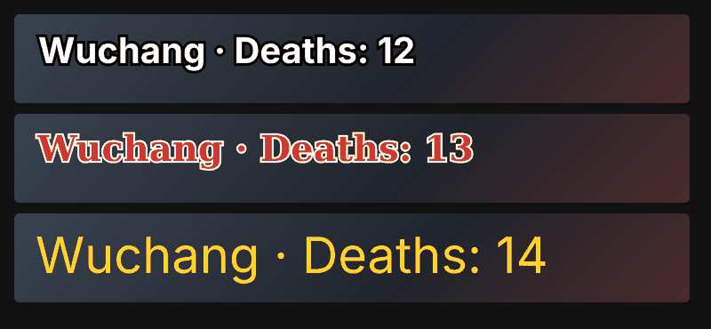

# Byrgenwerth

A small app for Windows and macOS that supports you while you play. Formerly Death Counter. It has two tools:

- **Death count**: counts how many times you die, automatically. It reads the screen with the OCR built into the system ("YOU DIED", "WASTED", "DEAD"...) and shows the count as an on-screen overlay or in OBS.
- **Translate**: translates game dialogue from English to Vietnamese in real time, in a box next to the dialogue. New, and not yet tried on a real game.

**[Tiếng Việt bên dưới](#tiếng-việt)** · **[Install](#quick-start)** · **[User guide](docs/user-guide.md)** · **[Hướng dẫn sử dụng](docs/huong-dan-su-dung.md)**

## Features

- **Real-time translation (EN → VI)**: draw a box around the dialogue and the translation appears next to it. Uses your own Anthropic API key, encrypted with your Windows account or kept in the Mac Keychain. Off until you turn it on; only the text in that box, the lines before it and the game name are sent. See [section 11 of the guide](docs/user-guide.md#11-translate-tab-real-time-dialogue-translation).
- **Automatic death detection** with the system OCR. No setup for games with a readable death banner.
- **Presets for 100 popular games**: 37 with verified death-screen text, the rest fall back to a generic keyword list. Not every game counts on its own: see the [list of supported games](docs/user-guide.md#supported-games) for what works out of the box, and [docs/death-screens-top100.csv](docs/death-screens-top100.csv) for the research and sources.
- **Games without a death screen**: counts a death when the health bar empties and the screen fades to black. Works with HUD bars and with health shown on the character (Dead Space).
- **Self-learning templates**: the first OCR hit saves a screenshot template, so stylized frames OCR misreads later are still caught. Games without death text can be taught with one hotkey press (F9).
- **Display anywhere**: click-through on-screen overlay, OBS Browser Source (keeps your text style, works with Game Capture), or a plain text file.
- **Text style**: font, size, bold, color, outline width and color.
- **Hotkeys**: F9 +1 and learn template · F10 −1 · F11 capture template · F8 toggle detection · F7 hide/show the app · Ctrl+Alt+T toggle translation · Ctrl+Alt+R redraw the dialogue region.
- **Optional sound** on every count (bring your own .mp3 / .wav).
- **One-line install and update** from PowerShell. The app and its data stay in one folder; **uninstall** from the app removes everything. Death count needs no internet; Translate does.



## Quick start

1. Open PowerShell and run the command below. The first time it asks where to install; run it again to update.
   ```powershell
   irm https://raw.githubusercontent.com/nguucode/byrgenwerth/main/install.ps1 | iex
   ```
2. Click **+ Thêm** (Add) and type your game's name. If it is one of the 100 presets, keywords are set automatically.
3. Play. When the death screen appears, the counter goes up.
   If it doesn't (stylized or missing text), press **F9** once on the death screen; the app learns it.
4. For OBS: tab **Hiển thị** → **Copy** the Browser Source URL → in OBS add a *Browser* source, width 1200, height 250.

On macOS 14 or newer, run this in Terminal instead:

```bash
curl -fsSL https://raw.githubusercontent.com/nguucode/byrgenwerth/main/install.sh | sh
```

Full walkthrough: **[docs/user-guide.md](docs/user-guide.md)**.

## Requirements and limits

- Windows 10 or 11, 64-bit, or macOS 14 or newer. The Mac version is new and has not been tried with a game yet.
- OCR uses the languages installed in Windows. English works out of the box on most PCs; for games in other languages add that language in *Settings → Time & language → Language & region*.
- Games must run in **Borderless** or **Windowed** mode. Exclusive fullscreen hides the screen from capture and hides the overlay.
- Project status: early. Death counting, overlay and OBS output have been used on a real setup; OCR language selection is new and lightly tested. Please open an issue with a screenshot if something is off.

## Build from source

Requires Go 1.24+. Releases are built on Windows and macOS by GitHub Actions when a `v*` tag is pushed (`.github/workflows/release.yml`).

```sh
go test ./...
scripts/build-mac.sh   # on a Mac, needs Xcode or its command line tools
GOOS=windows GOARCH=amd64 go build -ldflags "-H windowsgui -s -w" -o Byrgenwerth.exe .
```

`rsrc_windows_amd64.syso` holds the manifest and icon; regenerate it with
`go install github.com/akavel/rsrc@latest && rsrc -manifest app.manifest -ico icon.ico -arch amd64 -o rsrc_windows_amd64.syso`.
On Windows the UI uses [lxn/walk](https://github.com/lxn/walk) and OCR calls `Windows.Media.Ocr` through WinRT directly (no cgo). On macOS the UI is a local web page in a native window, with ScreenCaptureKit and Vision behind it. The death count and translation logic in `engine.go` is shared.

## License

[MIT](LICENSE). No sound files are bundled.

---

## Tiếng Việt

App nhỏ gọn cho Windows và macOS, hỗ trợ bạn khi chơi game, tên cũ là Death Counter. App có hai công cụ:

- **Death count**: **tự đếm số lần chết**. App đọc màn hình bằng OCR có sẵn của hệ điều hành ("YOU DIED", "WASTED", "DEAD"...) rồi hiện số đếm bằng overlay trên màn hình hoặc trong OBS.
- **Translate**: dịch hội thoại trong game từ tiếng Anh sang tiếng Việt theo thời gian thực, hiện trong một khung cạnh hội thoại. Mới thêm, chưa thử với game thật.

### Tính năng

- **Dịch real-time (Anh → Việt)**: khoanh vùng hội thoại là bản dịch hiện ngay bên cạnh. Dùng API key Anthropic của bạn, mã hóa theo tài khoản Windows hoặc lưu trong Keychain của Mac. Chưa bật thì không gửi gì; khi bật chỉ gửi chữ trong vùng khoanh, các câu trước đó và tên game. Xem [mục 11 trong hướng dẫn](docs/huong-dan-su-dung.md#11-tab-translate-dịch-hội-thoại-theo-thời-gian-thực).
- **Tự nhận màn chết** bằng OCR của hệ điều hành. Game có chữ chết dễ đọc thì không cần cài đặt gì.
- **Mẫu cho 100 game phổ biến**: 37 game đã xác minh chữ màn chết, số còn lại dùng bộ từ khóa chung. Không phải game nào cũng tự đếm được: xem [danh sách game được hỗ trợ](docs/huong-dan-su-dung.md#game-được-hỗ-trợ) để biết game nào chạy sẵn. Dữ liệu và nguồn tra cứu ở [docs/death-screens-top100.csv](docs/death-screens-top100.csv).
- **Game không có màn chết**: đếm khi thanh máu về 0 rồi màn hình tối đen. Dùng được cả thanh máu HUD lẫn máu hiện trên người nhân vật (Dead Space).
- **Tự học ảnh mẫu**: lần đầu OCR bắt được, app lưu ảnh màn chết làm mẫu, sau này OCR đọc trượt thì ảnh mẫu bắt thay. Game không có chữ chết thì bấm F9 một lần để dạy.
- **Hiển thị**: overlay nổi trên game (chuột bấm xuyên qua), OBS Browser Source (giữ nguyên kiểu chữ, dùng được với Game Capture), hoặc file text.
- **Kiểu chữ**: font, cỡ chữ, đậm, màu chữ, viền và màu viền.
- **Phím tắt**: F9 +1 và học mẫu · F10 −1 · F11 chụp mẫu · F8 bật/tắt nhận diện · F7 ẩn/hiện app · Ctrl+Alt+T bật/tắt dịch · Ctrl+Alt+R khoanh lại vùng hội thoại.
- **Âm thanh xác nhận** mỗi lần đếm (tự chọn file .mp3 / .wav).
- **Cài và cập nhật bằng một lệnh** PowerShell. App và dữ liệu nằm chung một thư mục; **gỡ cài đặt** ngay trong app sẽ xóa sạch. Death count không cần internet; Translate thì cần.

### Bắt đầu nhanh

1. Mở PowerShell, chạy lệnh dưới. Lần đầu script hỏi thư mục cài; chạy lại để cập nhật.
   ```powershell
   irm https://raw.githubusercontent.com/nguucode/byrgenwerth/main/install.ps1 | iex
   ```
2. Bấm **+ Thêm**, gõ tên game. Game nằm trong 100 mẫu thì app tự nạp từ khóa.
3. Vào chơi. Màn chết hiện ra là số tự tăng. Nếu không tăng (chữ cách điệu hoặc không có chữ), bấm **F9** một lần ngay lúc màn chết đang hiện.
4. Dùng OBS: tab **Hiển thị** → **Copy** URL Browser Source → trong OBS thêm nguồn *Browser*, Width 1200, Height 250.

Trên macOS 14 trở lên, chạy lệnh này trong Terminal:

```bash
curl -fsSL https://raw.githubusercontent.com/nguucode/byrgenwerth/main/install.sh | sh
```

Hướng dẫn chi tiết: **[docs/huong-dan-su-dung.md](docs/huong-dan-su-dung.md)**.

### Yêu cầu và giới hạn

- Windows 10 hoặc 11, 64-bit, hoặc macOS 14 trở lên. Bản Mac mới thêm, chưa thử với game thật.
- OCR dùng ngôn ngữ đã cài trong Windows. Game tiếng Trung/Nhật/Việt... thì thêm ngôn ngữ đó trong *Settings → Time & language → Language & region*.
- Game phải chạy **Borderless** hoặc **Windowed**. Exclusive Fullscreen làm app không chụp được màn hình và che mất overlay.
- Tình trạng: bản sớm. Đếm số, overlay và OBS đã chạy trên máy thật; chọn ngôn ngữ OCR mới thêm, còn ít được thử. Gặp lỗi thì mở issue kèm ảnh chụp màn hình.
